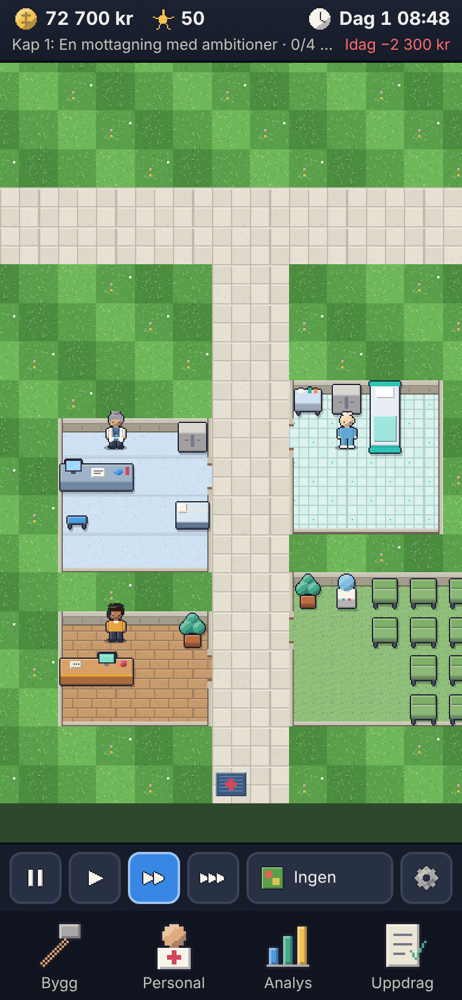

# Pixel Hospital

Ett sjukhusbyggarspel i pixelgrafik för iPhone – från en liten vårdmottagning till regionens bästa sjukhus.
*A mobile-first hospital tycoon (PWA) in Swedish, built with TypeScript, Phaser 4 and Vite.*

**Spela:** https://nelle64.github.io/hospitel-tucoon/ (öppna i Safari → Dela → Lägg till på hemskärmen)



## Features
- 18 room types, 24 diseases, 9 staff roles, 12 skills/trainings, 12 research projects, 12 missions, 12 events, 5 chapters + final inspection.
- Individual patients and staff with real pathfinding, shifts, energy, queues and bookings; deterministic, seeded simulation.
- Original generated pixel art and sounds, offline play, local saves with export/import.

## Development (cloud / CI)
```
npm ci
npm run assets          # generate pixel art + audio
npm test                # unit + integration
npm run test:campaign   # headless campaign with bots
npm run build && npm run e2e
npm run balance         # multi-seed balance study
npm run test:stress     # long-term stability
```
Documentation: `docs/` – design, architecture, implementation status, acceptance matrix/report, balance, assets, performance, mobile QA, release notes. Project conventions: `CLAUDE.md`.
